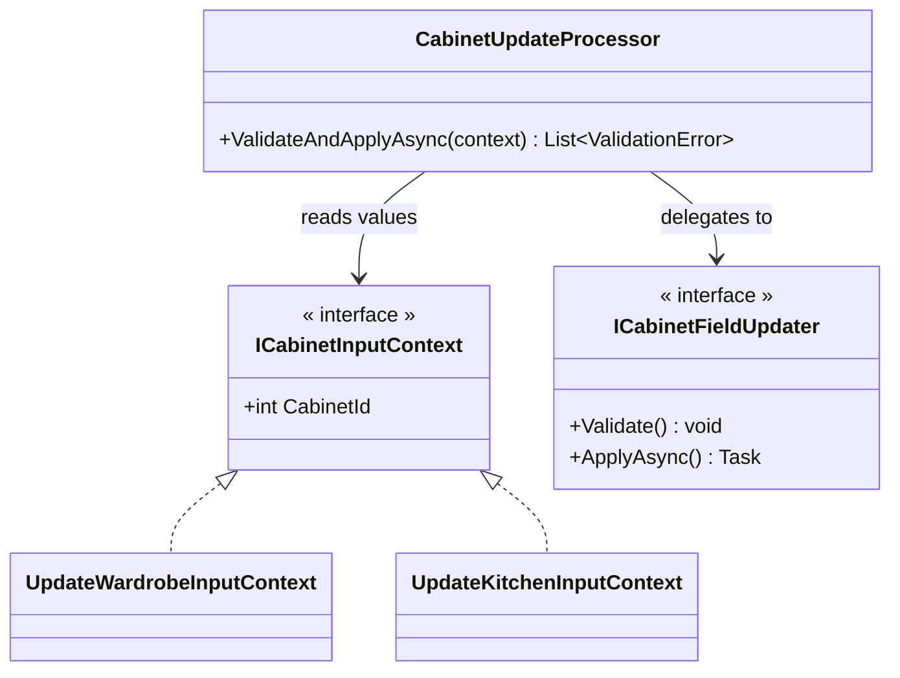
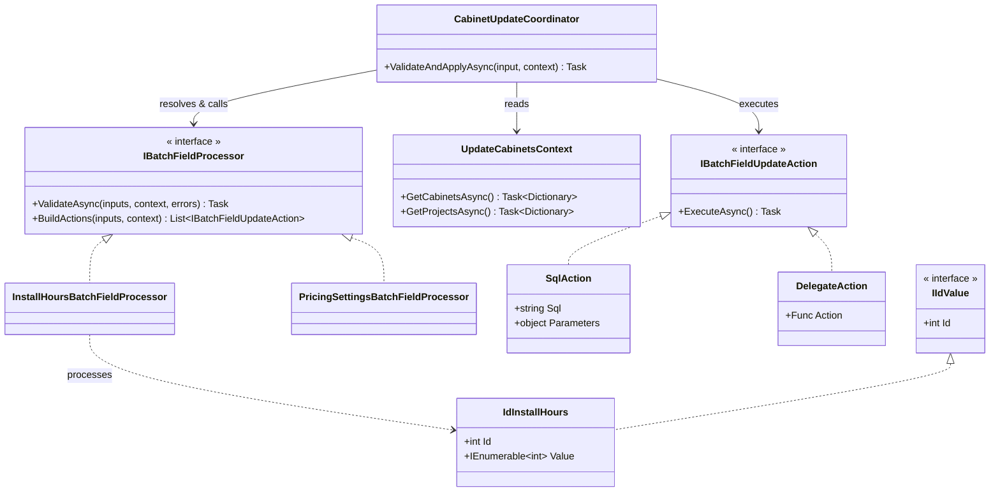
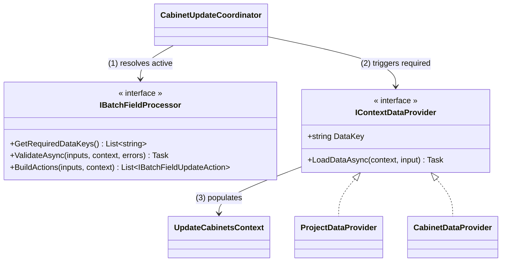

> 中文版：[[zh/engineering/carving-at-the-joints|沿著關節下刀：重構中如何找到恰到好處的抽象]]

This post is a refactoring exercise. The scenario is fictional, but the code problems, the wrong turns along the way, and the final trade-offs all come from a real refactor.

## The Scenario

Imagine the internal system of a custom cabinetry company. For each renovation **project**, a designer plans many **cabinets**, and there are five kinds of cabinet: wardrobe, bookcase, shoe cabinet, TV cabinet, and kitchen cabinet.

The five kinds are **highly homogeneous**. Almost every field is shared, and only a few fields belong to a single kind:

| Field | Wardrobe | Bookcase | Shoe cabinet | TV cabinet | Kitchen |
|---|:-:|:-:|:-:|:-:|:-:|
| Name, dimensions | ✓ | ✓ | ✓ | ✓ | ✓ |
| Board material, door style | ✓ | ✓ | ✓ | ✓ | ✓ |
| Pricing mode | ✓ | ✓ | ✓ | ✓ | ✓ |
| Quote cap, cost cap | ✓ | ✓ | ✓ | ✓ | ✓ |
| Installation hours | ✓ | ✓ | ✓ | ✓ | ✓ |
| Assigned craftsmen, excluded craftsmen | ✓ | ✓ | ✓ | ✓ | ✓ |
| Elevator booking slot | ✓ | | | | ✓ |
| Hanging rod layout | ✓ | | | | |
| Countertop material | | | | | ✓ |

Cabinets can be edited in two ways:

- **Single edit**: each kind of cabinet has its own API, five in total
- **Batch edit**: select many cabinets at once (across kinds) and change only a few fields. For example, a designer swaps the door style on all twenty cabinets in a house in one go

The two inputs are transposed:

```cs
// Single edit: one cabinet, many fields
class UpdateWardrobeInput
{
    public int Id { get; set; }
    public IEnumerable<int> InstallHours { get; set; }
    public IEnumerable<int> BoardIds { get; set; }
}

// Batch edit: one field, many cabinets
class BatchUpdateCabinetsInput
{
    public IEnumerable<IdInstallHours> InstallHours { get; set; }  // [{ Id, Value }, ...]
    public IEnumerable<IdBoards> BoardIds { get; set; }
}
```

A single edit is "one cabinet × many fields"; a batch edit is "one field × many cabinets".

Every write must be validated first, and many validations need the database. For example:

- The selected boards must be in the brand catalog the project is contracted with, and must not be discontinued
- The pricing mode (by length or by piece) must match the project's
- The requested elevator slot must not already be taken by another cabinet
- "Assigned craftsmen" and "excluded craftsmen" cannot both be set

---

## The Current State: Five Nearly Identical Copies

Here are the validation sections of "edit wardrobe" and "edit kitchen cabinet" side by side:

```cs
public async Task UpdateWardrobeAsync(UpdateWardrobeInput input, UserContext user)
{
    var cabinet = await _db.GetCabinetAsync(input.Id);
    var project = await _db.GetProjectAsync(cabinet.ProjectId);

    ThrowOnInconsistentPricingModeWithProject(project.PricingMode, input.PricingMode);
    await ThrowOnBoardNotInBrandCatalogAsync(input.BoardIds, cabinet.ProjectId);
    await ThrowOnProjectNotViewableAsync(cabinet.ProjectId, user);    // queries project again inside
    ThrowOnBoardDiscontinued(input.BoardIds, boardInfo);
    ThrowOnConflictingCraftsmen(input.AssignedCraftsmen, input.ExcludedCraftsmen);
    await ThrowOnElevatorSlotTakenAsync(input.ElevatorSlotId);
    ThrowOnInvalidHangingRod(input.HangingRod);
    // ...twenty-odd more lines

    // once validation passes, write field by field
}

public async Task UpdateKitchenAsync(UpdateKitchenInput input, UserContext user)
{
    var cabinet = await _db.GetCabinetAsync(input.Id);
    var project = await _db.GetProjectAsync(cabinet.ProjectId);

    ThrowOnInconsistentPricingModeWithProject(project.PricingMode, input.PricingMode);
    await ThrowOnProjectNotViewableAsync(cabinet.ProjectId, user);
    await ThrowOnBoardNotInBrandCatalogAsync(input.BoardIds, cabinet.ProjectId);
    ThrowOnBoardDiscontinued(input.BoardIds, boardInfo);
    await ThrowOnElevatorSlotTakenAsync(input.ElevatorSlotId);
    ThrowOnInvalidCountertop(input.Countertop);
    // what about the assigned / excluded craftsmen check? Missing.
    // ...
}
```

The two methods are 90% the same. They differ only in a few kind-specific fields, plus some differences that could be either intentional or accidental: a different order here, a missing check there. Five kinds of cabinet means five copies like this.

The problems fall into two groups:

**1. Rules for shared fields are copied into every kind of cabinet ([Shotgun Surgery](https://refactoring.guru/smells/shotgun-surgery)).** "Assigned and excluded craftsmen cannot both be set" is clearly a rule shared by all cabinets, yet it has to be called separately in each of the five APIs. Changing one rule means editing several places; forgetting one of them when adding a rule produces a bug that only shows up for one kind of cabinet. The rules for a single field are also often split across several `ThrowOn...` calls scattered in different places.

**2. Redundant database reads.** Each `ThrowOn...` fetches the data it needs on its own, unaware of what the others have already fetched. In the wardrobe example above, the same `project` is queried more than once.

Batch edit goes through a separate path. Its structure is much better, but it has problems of its own:

- **[Long Method](https://refactoring.guru/smells/long-method)**: every async validation is crammed into one long `ValidateAsync`
- **[Shotgun Surgery](https://refactoring.guru/smells/shotgun-surgery)**: the fields to update are listed by hand, one by one, and the more fields there are, the easier it is to miss one

---

## The Challenge

If this were your codebase, how would you refactor it?

The goal is to remove the smells above: rules for shared fields are written once, the same data is not queried twice within a request, and adding a field does not require registering it by hand. Single edit and batch edit are currently two separate paths; ideally they would converge into one.

There is also one constraint: a batch edit can touch dozens of cabinets at once, and the refactor must not make it slower.

---

## Write Down the Principles First

Faced with five nearly identical copies, it is tempting to reach straight for a pattern: Strategy, Template Method, or a shared base class. But before choosing any pattern, turn the goals and the constraint into principles that candidate designs can be checked against:

1. Each field can describe for itself "how I am validated" and "how I am updated"
2. Validations for different fields never query the same data twice
3. The fields to update are inferred from the user's input, not listed by hand
4. It is at least as fast as the existing batch edit

The first three come from the smells; the fourth comes from the constraint. With them written down, every candidate can be checked line by line, instead of judging by gut feeling which one is "better".

The first principle sets the direction of the whole design: **organize around fields, not around cabinet kinds.**

The reason goes back to the field table. The differences between the five kinds are concentrated in a handful of fields; the shared part is the vast majority. Cut along kinds, and every kind has to handle the shared fields again, which is exactly the current state. Cut along fields, and the rules for shared fields are written once, while the differences between kinds shrink to a few kind-specific fields or a conditional branch inside one field (for example, "only wardrobes and kitchen cabinets can have an elevator slot").

==Cut along the dimension with the most in common, and the differences become a few exceptions; cut along the differences, and what they have in common gets copied everywhere.==

### Let Each Field Describe Its Own Rules

The idea of "each field describes how it is validated" comes from ASP.NET Core's [model validation](https://learn.microsoft.com/en-us/aspnet/core/mvc/models/validation?view=aspnetcore-10.0). In ASP.NET Core, validation rules are attributes placed directly on the model's properties:

```cs
public class Cabinet
{
    [Required]
    [StringLength(50)]
    public string Name { get; set; }

    [Range(30, 300)]
    public int WidthCm { get; set; }
}
```

When a request comes in, the framework uses reflection to find the attributes on each property, runs them one by one, and collects the errors. The caller doesn't need to know which rules exist, and adding a rule doesn't touch the caller; you just add another attribute to the property.

This pattern fits the scenario well, for two reasons:

- **It is organized around fields by nature.** Rules follow properties, not kinds, which matches the conclusion above. As long as the five kinds share a field, they share its rules.
- **It eliminates the "registration list".** The root problem today is that every entry point has to remember which `ThrowOn...` calls to make. Binding rules to fields turns "if this field is present, check these rules" into a structural guarantee rather than something people have to remember.

But it can't be used as is, because the requirements here go beyond what the built-in attributes can do:

| | ASP.NET Core model validation | This scenario |
|---|---|---|
| Where rules live | Attributes on properties | Same |
| What validation needs | Usually just the value itself | Often the database (board catalog, elevator slots) |
| Execution | Synchronous `IsValid` | Needs to be async |
| Responsibility | Validation only | Validation, then writing |
| Target | One model | A batch of cabinets |

So we can borrow its skeleton (rules declared on fields, found and run by the framework via reflection), but keep the attribute itself free of logic. It only points to a class that can query data, handle a whole batch, and produce write actions. We'll see what that looks like later.

---

## How Big Should a Unit Be?

With fields as the axis, the remaining question is: **what should one "unit of processing" contain?** There is no obvious answer, so let's start with the largest unit and keep cutting smaller.

### Option 1: The Whole Request Is One Unit

Put the user's input and the pre-fetched DB data into one context, and let the context use reflection to find the fields that have values, then validate and update them one by one.



At first glance it satisfies every principle, but implementation gets stuck on one thing: **single edit and batch edit have completely different input shapes.** Recall the two classes from the scenario: one is "one cabinet × many fields", the other is "one field × many cabinets", and it's hard to extract a common interface from them. Force it, and the context has to understand both shapes while also owning the data and logic for every field. That's just building a new God Object.

This unit is too big.

### Option 2: Each (id, value) Pair Is One Unit

Since the two inputs won't merge, cut all the way down: treat each `{ cabinet Id, field value }` as an independent item that carries its own validation and update logic, and have a processor iterate over them.

```cs
interface IIdValue<TValue>
{
    int Id { get; }
    TValue Value { get; }
    void Validate();
    Task ApplyAsync();
}
```

This is the **conceptually cleanest** of the three. A single edit is a few `IIdValue`s, and so is a batch edit; the difference in shape disappears.

But go back to the constraint from the challenge. Imagine a designer selects twenty cabinets and sets their installation hours to 9 a.m.–5 p.m. In this option, that's twenty independent `IIdValue`s, each running its own `UPDATE`. What used to be one SQL statement becomes twenty. That directly violates the fourth principle.

On top of that, letting the "field value" carry business logic ties data and behavior together too tightly.

This unit is too small.

### Option 3: One Field × the Whole Batch of Cabinets Is One Unit

In between sits a unit of "one field, plus every cabinet that changes this field". That's exactly the input shape batch edit already uses; a single edit can be converted into "a batch of one cabinet".

At the same time, separate the data and behavior that Option 2 mixed together. The architecture has five roles:

- **`IIdValue`**: holds data only (`Id` and `Value`), no logic
- **`IBatchFieldProcessor`**: one processor per field, responsible for validating that field across the whole batch and producing update actions
- **`IBatchFieldUpdateAction`**: an update action, either a raw SQL statement (`SqlAction`) or a delegation to another repository for more complex writes (`DelegateAction`)
- **`UpdateCabinetsContext`**: the data that validation and updates need, queried the first time it's accessed and reused for the rest of the request
- **`CabinetUpdateCoordinator`**: uses reflection to find the fields with values in the input and their processors, has every processor validate first, and only executes the update actions once all of them pass



A processor for a simple field looks roughly like this:

```cs
public class InstallHoursBatchFieldProcessor : IBatchFieldProcessor<IdInstallHours>
{
    public Task ValidateAsync(
        IReadOnlyList<IdInstallHours> inputs,
        UpdateCabinetsContext context,
        List<ValidationError> errors)
    {
        foreach (var input in inputs.Where(x => x.Value.Any(h => h < 0 || h > 23)))
        {
            errors.Add(new ValidationError("Install hours must be between 0 and 23.", input));
        }
        return Task.CompletedTask;
    }

    public IEnumerable<IBatchFieldUpdateAction> BuildActions(
        IReadOnlyList<IdInstallHours> inputs,
        UpdateCabinetsContext context)
    {
        // Cabinets with the same setting share one UPDATE: twenty cabinets set to the same hours need only one SQL statement
        foreach (var group in inputs.GroupBy(x => string.Join(",", x.Value.OrderBy(h => h))))
        {
            yield return new SqlAction(
                "UPDATE cabinet SET install_hours = @Hours WHERE id IN @Ids",
                new { Hours = group.Key, Ids = group.Select(x => x.Id) });
        }
    }
}
```

This is where the skeleton borrowed from model validation comes in. Each input field only needs to be marked with its processor:

```cs
public class BatchUpdateCabinetsInput
{
    [BatchFieldProcessor(typeof(InstallHoursBatchFieldProcessor))]
    public IEnumerable<IdInstallHours> InstallHours { get; set; }

    // ... and other fields
}
```

#### A Lazily Loaded Context

The most direct way to "never query the same data twice" is to fetch everything that might be needed before validation starts. But that creates a different problem: if the user only changed something like installation hours, which needs no extra data, all those queries were wasted. Redundant reads are gone, replaced by over-fetching.

So every piece of data in the context is wrapped in a `Lazy<Task<T>>` and only queried the first time someone asks for it:

```cs
public class UpdateCabinetsContext
{
    private readonly IEnumerable<int> _cabinetIds;
    private readonly CabinetDbAccess _cabinetDb;
    private readonly ProjectDbAccess _projectDb;

    private readonly Lazy<Task<Dictionary<int, Cabinet>>> _lazyCabinets;
    private readonly Lazy<Task<Dictionary<int, Project>>> _lazyProjects;

    public UpdateCabinetsContext(IEnumerable<int> cabinetIds, CabinetDbAccess cabinetDb, ProjectDbAccess projectDb)
    {
        _cabinetIds = cabinetIds;
        _cabinetDb = cabinetDb;
        _projectDb = projectDb;

        _lazyCabinets = new Lazy<Task<Dictionary<int, Cabinet>>>(LoadCabinetsAsync);
        _lazyProjects = new Lazy<Task<Dictionary<int, Project>>>(LoadProjectsAsync);
    }

    public Task<Dictionary<int, Cabinet>> GetCabinetsAsync() => _lazyCabinets.Value;
    public Task<Dictionary<int, Project>> GetProjectsAsync() => _lazyProjects.Value;

    private async Task<Dictionary<int, Cabinet>> LoadCabinetsAsync()
    {
        var cabinets = await _cabinetDb.GetByIdsAsync(_cabinetIds);
        return cabinets.ToDictionary(c => c.Id);
    }

    private async Task<Dictionary<int, Project>> LoadProjectsAsync()
    {
        var cabinets = await GetCabinetsAsync();   // depends on other data; just ask for it
        var projectIds = cabinets.Values.Select(c => c.ProjectId).ToHashSet();
        var projects = await _projectDb.GetByIdsAsync(projectIds);
        return projects.ToDictionary(p => p.Id);
    }
}
```

This approach has a few properties worth noting:

- **Queried only when used.** If no processor calls `GetProjectsAsync()`, projects are never queried.
- **Queried only once.** `Lazy` caches the `Task` itself, not the query result. So even if two processors call it at the same time before the first query finishes, they get the same `Task`, and only one query goes out.
- **Dependencies between data just work.** Projects can only be queried once we know which projects the cabinets belong to; `LoadProjectsAsync` simply calls `GetCabinetsAsync()`, with no separate load ordering to arrange.
- **Easy to test.** Add a constructor that takes pre-built data, and processor unit tests never need to touch the database.

#### Checking Against the Four Principles

1. **Each field describes how it is validated and updated**: it all lives in that field's processor, so changing a field's behavior means reading one file
2. **No duplicate queries**: processors get data from `UpdateCabinetsContext`, where each piece of data is queried at most once per request, and not at all if nobody uses it
3. **No hand-listed update fields**: the coordinator uses reflection to find the fields with values in the input
4. **No slower than batch edit**: writes for the same field across the batch can be merged into one SQL statement

There are also a few side benefits:

- **Kind is no longer the axis.** The five single-edit APIs and batch edit share the same processors, and differences between kinds are contained inside a few processors.
- **Errors are collected and returned together.** `ValidateAsync` adds errors to a list instead of throwing, so the user sees every problem at once.
- **Validate everything, then write everything.** `BuildActions` only produces actions without running them, so if any field fails validation, no field is left half-written.
- **Easy to test.** Each processor's input is a batch of `IIdValue`s plus a context pre-filled with data. No database, so unit tests are straightforward.

### What Sets the Three Options Apart

| | Unit | Where it gets stuck |
|---|---|---|
| Option 1 | The whole request | The two input shapes can't be unified; the context becomes a God Object |
| Option 2 | One (id, value) pair | The unit is smaller than SQL's natural unit; a batch write turns into N SQL statements |
| Option 3 | One field × the whole batch | — |

Option 1's unit is too big, too big to hold both input shapes. Option 2's unit is too small, too small to line up with the database's unit.

Option 2 deserves a second look. From the code's point of view, "one (id, value) pair" is the most natural unit. But the most expensive operation in this system is SQL, and SQL's natural unit is "one column, a batch of rows". Option 2 cuts along the code's joints but cuts right through SQL's. So when looking for where to cut, besides asking what the cleanest conceptual cut is, also ask: "**What is the most expensive operation in the system, and what is its natural unit?**" Option 3's unit lines up with both.

---

## Where the Abstraction Leaks

"One processor per field" handles most rules, but not all of them.

**Cross-field rules.** The quote cap and the cost cap depend on each other: validating one requires knowing the other's value, and the user may have changed only one of them. Split them into two processors, and both sides have to handle "was the other field changed too?". The pragmatic choice is to merge them into a single `PricingSettingsBatchFieldProcessor`. Rules that span even more fields (for example, "under a certain pricing mode, certain combinations of fields are invalid") can live in the coordinator, as a separate cross-field validation pass.

**The context becomes a hub for every data source.** Lazy loading solves both redundant reads and over-fetching, but every piece of data any processor needs must have a `GetXxxAsync()` on the context. The more processors there are, the more DB access objects the context depends on. In a system with over forty fields, its constructor can easily end up with a dozen-plus parameters. The processors are decoupled from each other, but the context they all depend on keeps growing.

Another design is to have each processor explicitly declare what data it needs, and let separate data providers load it:



The trade-offs:

| | Lazy loading | Explicit declaration (data providers) |
|---|---|---|
| Avoiding over-fetching | Queried when used | Only what's declared is queried |
| Dependencies between data | Just ask for it in the Load method | Providers need to be ordered separately |
| What data a processor needs | Have to read the code | Visible right on the interface |
| Adding a new kind of data | Change the one context class | Add a new provider |
| Extra indirection | None | An extra layer mapping providers to keys |

Lazy loading solves the performance problem with the least structure, at the cost of a context class that keeps growing. Explicit declaration splits the data sources apart, at the cost of an extra layer of indirection and having to handle data dependencies yourself. Until the context gets too big to maintain, lazy loading is the better deal.

---

## Back to the Challenge

**Are the smells gone?** Single edit and batch edit share the same set of processors, and the five single-edit APIs no longer each maintain their own validation list. The case from the beginning, where the kitchen cabinet was missing the assigned / excluded craftsmen check, is now structurally impossible: if a field is in the input, the coordinator will always find its processor. Changing a shared rule means changing one processor, and adding a field follows a fixed set of steps:

1. Make the field's input type implement `IIdValue`
2. Create a processor for the field that implements `IBatchFieldProcessor`
3. Put the validation logic in `ValidateAsync` and the update logic in `BuildActions`
4. If it needs new data, add a lazily loaded `GetXxxAsync()` to the context
5. Mark the input field with `[BatchFieldProcessor(typeof(...))]` and register it with DI

**Did the constraint hold?** It did. Writes for the same field across the batch are merged into one SQL statement, and a single edit is just "a batch of one cabinet". After it shipped, neither the five single-edit APIs nor batch edit got any slower.

---

## Takeaways

- Turn goals and constraints into principles before choosing a design; the most easily overlooked constraint is often the one that rules out the most options
- Cut along the dimension with the most in common, so that differences become a few exceptions
- Declare rules on the fields they belong to, so that "if this field is present, check these rules" is a structural guarantee rather than something people have to remember
- A unit that's too big forces differently shaped things together; one that's too small falls out of step with the most expensive operation in the system
- When choosing a unit, consider the natural unit of the most expensive operation, not just the conceptual boundaries
- Accept that the abstraction has exceptions, and give them an explicit, centralized home
- Every solution has a cost: loading everything up front fixes redundant reads but causes over-fetching; lazy loading fixes both but turns the context into a hub for every data source
