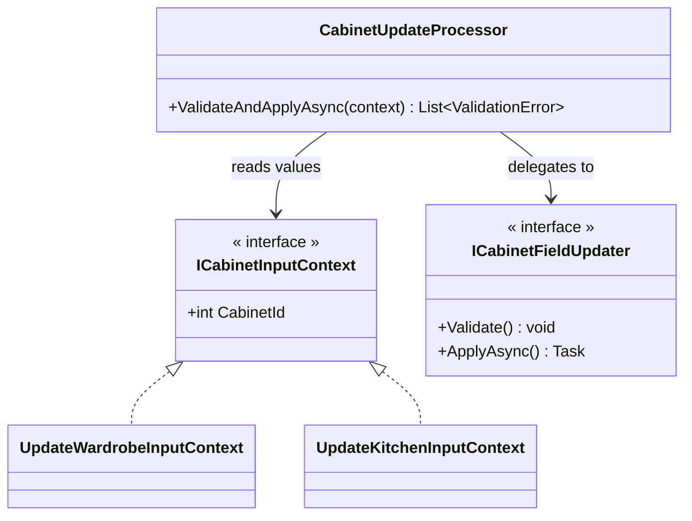
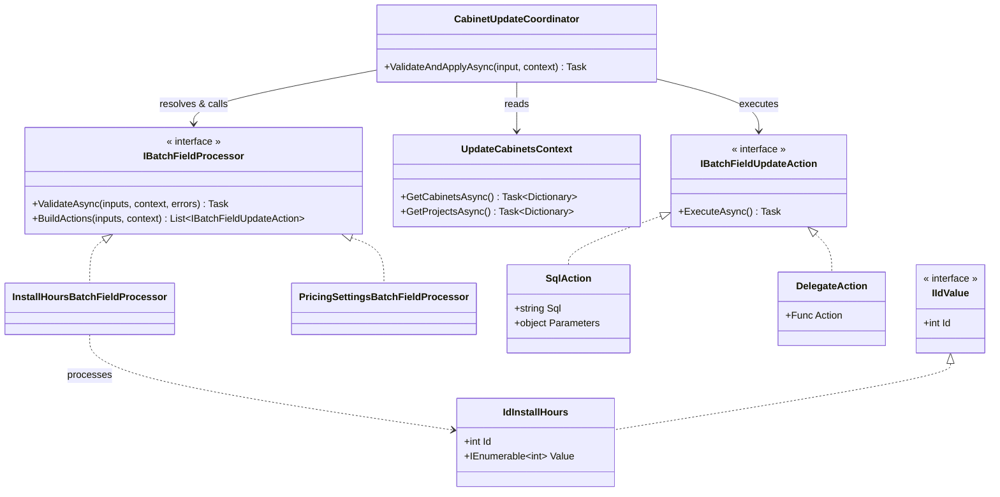
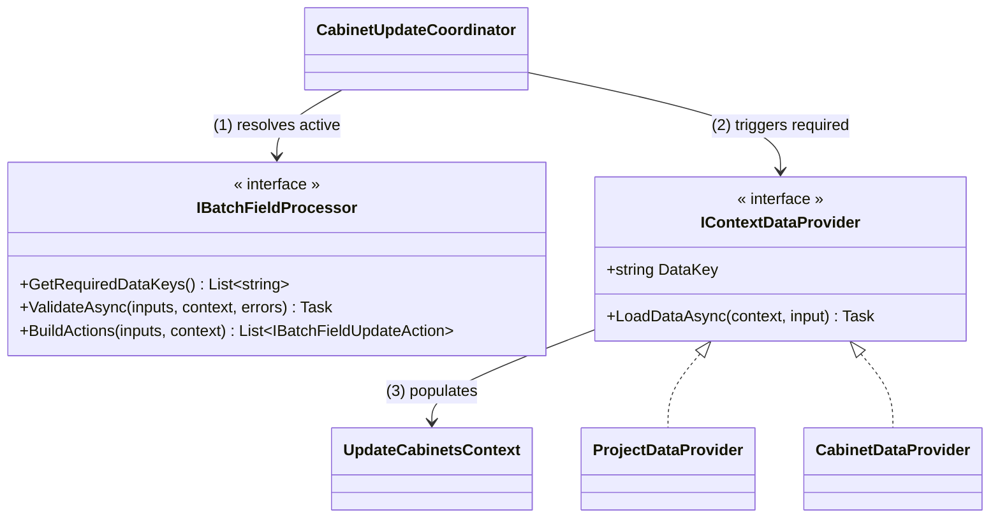

> English version: [[engineering/carving-at-the-joints|Carving at the Joints: Deciding Where to Cut in a Messy Refactor]]

這篇文章是一道重構題。情境是虛構的，但程式碼的問題、中途走錯的路，以及最後的取捨，都來自一次真實的重構。

## 情境

想像一間系統櫃公司的內部系統。設計師為每個**裝修案**（Project）規劃很多座**櫃體**（Cabinet），櫃體有五種：衣櫃、書櫃、鞋櫃、電視櫃、廚具。

這五種櫃體的**同質性非常高**。絕大部分欄位都是共用的，只有少數欄位專屬於某一種：

| 欄位 | 衣櫃 | 書櫃 | 鞋櫃 | 電視櫃 | 廚具 |
|---|:-:|:-:|:-:|:-:|:-:|
| 名稱、尺寸 | ✓ | ✓ | ✓ | ✓ | ✓ |
| 板材、門板樣式 | ✓ | ✓ | ✓ | ✓ | ✓ |
| 計價方式 | ✓ | ✓ | ✓ | ✓ | ✓ |
| 報價上限、成本上限 | ✓ | ✓ | ✓ | ✓ | ✓ |
| 可安裝時段 | ✓ | ✓ | ✓ | ✓ | ✓ |
| 指定師傅、排除師傅 | ✓ | ✓ | ✓ | ✓ | ✓ |
| 電梯預約時段 | ✓ | | | | ✓ |
| 吊桿配置 | ✓ | | | | |
| 檯面材質 | | | | | ✓ |

櫃體有兩種編輯方式：

- **單個編輯**：每種櫃體各有一支 API，共五支
- **批次編輯**：一次勾選很多座櫃體（可以跨類型），只改其中幾個欄位。例如設計師把一整間房子二十座櫃體的門板樣式一次換掉

兩者的 input 形狀剛好相反：

```cs
// 單個編輯：一座櫃體，很多個欄位
class UpdateWardrobeInput
{
    public int Id { get; set; }
    public IEnumerable<int> InstallHours { get; set; }
    public IEnumerable<int> BoardIds { get; set; }
}

// 批次編輯：一個欄位，很多座櫃體
class BatchUpdateCabinetsInput
{
    public IEnumerable<IdInstallHours> InstallHours { get; set; }  // [{ Id, Value }, ...]
    public IEnumerable<IdBoards> BoardIds { get; set; }
}
```

單個編輯是「一座櫃體 × 多個欄位」，批次編輯是「一個欄位 × 多座櫃體」。

寫入前都要驗證，而很多驗證需要查資料庫。例如：

- 選的板材必須在這個裝修案簽約的品牌目錄內，而且還沒停產
- 計價方式（按尺計價或按件計價）必須和裝修案一致
- 預約的電梯時段不能已被其他櫃體佔用
- 「指定師傅」和「排除師傅」不能同時設定

---

## 現況：五份幾乎一樣的程式碼

把「編輯衣櫃」和「編輯廚具」的驗證段落並排來看：

```cs
public async Task UpdateWardrobeAsync(UpdateWardrobeInput input, UserContext user)
{
    var cabinet = await _db.GetCabinetAsync(input.Id);
    var project = await _db.GetProjectAsync(cabinet.ProjectId);

    ThrowOnInconsistentPricingModeWithProject(project.PricingMode, input.PricingMode);
    await ThrowOnBoardNotInBrandCatalogAsync(input.BoardIds, cabinet.ProjectId);
    await ThrowOnProjectNotViewableAsync(cabinet.ProjectId, user);    // 裡面又查一次 project
    ThrowOnBoardDiscontinued(input.BoardIds, boardInfo);
    ThrowOnConflictingCraftsmen(input.AssignedCraftsmen, input.ExcludedCraftsmen);
    await ThrowOnElevatorSlotTakenAsync(input.ElevatorSlotId);
    ThrowOnInvalidHangingRod(input.HangingRod);
    // ……再二十幾行

    // 驗證通過後，逐欄位寫入
}

public async Task UpdateKitchenAsync(UpdateKitchenInput input, UserContext user)
{
    var cabinet = await _db.GetCabinetAsync(input.Id);
    var project = await _db.GetProjectAsync(cabinet.ProjectId);

    ThrowOnInconsistentPricingModeWithProject(project.PricingMode, input.PricingMode);
    await ThrowOnProjectNotViewableAsync(cabinet.ProjectId, user);
    await ThrowOnBoardNotInBrandCatalogAsync(input.BoardIds, cabinet.ProjectId);
    ThrowOnBoardDiscontinued(input.BoardIds, boardInfo);
    await ThrowOnElevatorSlotTakenAsync(input.ElevatorSlotId);
    ThrowOnInvalidCountertop(input.Countertop);
    // 指定 / 排除師傅的檢查呢？漏了
    // ……
}
```

兩段程式碼有九成相同，差別只在少數專屬欄位，以及一些看不出是刻意還是遺漏的差異：順序不同、某個檢查少了一行。五種櫃體就有五份這樣的程式碼。

問題可以歸成兩類：

**1. 共用欄位的規則被複製到每一種櫃體裡（[Shotgun Surgery](https://refactoring.guru/smells/shotgun-surgery)）**：「指定師傅和排除師傅不能同時設定」明明是所有櫃體共用的規則，卻要在五支 API 裡各自呼叫一次。改一條規則得改好幾個地方；新增一條規則時漏掉其中一個，就是一個只在某種櫃體才會出現的 bug。同一個欄位的規則本身也常拆成好幾個 `ThrowOn...`，散落在不同位置。

**2. 重複讀取資料庫**：每個 `ThrowOn...` 都自己去查需要的資料，彼此不知道對方查過什麼。上面的衣櫃範例裡，同一個 `project` 被查了不只一次。

批次編輯走的是另一條獨立的路徑，結構好很多，但也有自己的問題：

- **[Long Method](https://refactoring.guru/smells/long-method)**：所有非同步驗證都塞在一個很長的 `ValidateAsync` 裡
- **[Shotgun Surgery](https://refactoring.guru/smells/shotgun-surgery)**：要更新哪些欄位是一個一個手動列出來的，欄位越多越容易漏

---

## 挑戰

如果這是你的 codebase，你會怎麼重構？

目標是消除上面這些 smell：共用欄位的規則只寫一次，同一份資料在一個請求裡不重複查，新增欄位時不需要手動登記。單個編輯和批次編輯目前是兩條獨立的路徑，最好也能收斂成同一套。

另外有一個限制：批次編輯一次可能改到幾十座櫃體，重構後的速度不能比現在慢。

---

## 先寫下原則

看到五份幾乎一樣的程式碼，很容易直接想到某個 pattern：Strategy、Template Method、或是一個共用的 base class。但在挑選任何 pattern 之前，先把目標和限制寫成可以用來檢驗方案的原則：

1. 每個欄位都能自己說明「我怎麼驗證」和「我怎麼更新」
2. 不同欄位的驗證不會重複查同一份資料
3. 不需要手動列出要更新哪些欄位，直接從使用者的 input 判斷
4. 速度至少要和現有的批次編輯一樣快

前三條來自 smell，第四條來自限制。寫下來之後，每個候選方案都可以逐條對照，而不是憑感覺判斷哪個比較「好」。

第一條決定了整個設計的方向：**以欄位為主軸，而不是以櫃體類型為主軸。**

理由回到那張欄位表。五種櫃體的差異只集中在少數幾個欄位，共用的部分佔了絕大多數。如果以類型為軸切，每種類型都得重複處理共用欄位，這正是現況的樣子；以欄位為軸切，共用欄位的規則只寫一次，類型之間的差異就只是少數專屬欄位，或某個欄位內的一個條件分支（例如「只有衣櫃和廚具可以設定電梯時段」）。

==沿著共通性最高的維度切分，差異就會變成少數例外；沿著差異切分，共通的部分就會被複製到處都是。==

### 讓欄位自己說明規則

「每個欄位自己說明怎麼驗證」這個想法，來自 ASP.NET Core 的 [model validation](https://learn.microsoft.com/en-us/aspnet/core/mvc/models/validation?view=aspnetcore-10.0)。在 ASP.NET Core 裡，驗證規則直接用 attribute 標在 model 的屬性上：

```cs
public class Cabinet
{
    [Required]
    [StringLength(50)]
    public string Name { get; set; }

    [Range(30, 300)]
    public int WidthCm { get; set; }
}
```

框架收到請求時，用反射找出每個屬性上的 attribute 並逐一執行，把錯誤收集起來回傳。呼叫端不需要知道有哪些規則，新增規則也不用改呼叫端，只要在屬性上多標一個 attribute。

這個模式很適合這裡的情境，原因有兩個：

- **它天生就以欄位為主軸**：規則跟著屬性走，不跟著類型走，正好對應上面的結論。只要五種櫃體共用同一個欄位，就共用同一組規則。
- **它消除了「註冊清單」**：現況的根本問題是每個進入點都要自己記得呼叫哪些 `ThrowOn...`。把規則綁在欄位上，「有這個欄位就檢查這些規則」就變成結構上的保證，而不是靠人記得。

但它不能直接拿來用，因為這裡的需求超出了內建 attribute 的能力範圍：

| | ASP.NET Core model validation | 這個情境 |
|---|---|---|
| 規則綁在哪裡 | 屬性上的 attribute | 同左 |
| 驗證需要什麼 | 通常只看值本身 | 經常要查資料庫（板材目錄、電梯時段） |
| 執行方式 | 同步的 `IsValid` | 需要非同步 |
| 負責什麼 | 只驗證 | 驗證之後還要寫入 |
| 處理對象 | 一個 model | 一批櫃體 |

所以可以借用它的骨架（規則宣告在欄位上、由框架用反射找出並執行），但 attribute 本身不放邏輯，只用來指向一個能查資料、能處理一整批、也能產生寫入動作的類別。後面會看到它長什麼樣子。

---

## 處理單位要切多大？

確定以欄位為主軸之後，剩下的問題是：**一個「處理單位」應該包含什麼？** 這個問題沒有顯而易見的答案，以下從最大的單位開始，一路往小切。

### 方案一：一整個請求是一個單位

把使用者的 input 和查好的 DB 資料一起丟進一個 context，由 context 透過反射找出有值的欄位，逐一驗證、更新。



乍看之下它滿足所有原則，但實作時會卡在一個地方：**單個編輯和批次編輯的 input 形狀根本不一樣。** 回到情境裡的那兩個 class，一個是「一座櫃體 × 多個欄位」，一個是「一個欄位 × 多座櫃體」，兩者很難抽出共同介面。硬要做的話，context 得同時理解兩種形狀，還要承擔所有欄位的資料和邏輯，等於造出一個新的 God Object。

這個單位太大了。

### 方案二：每一筆 (id, value) 是一個單位

既然兩種 input 整合不起來，那就切到最碎：把每個 `{ 櫃體 Id, 欄位值 }` 都當成獨立個體，各自帶著驗證和更新邏輯，由一個 processor 遍歷它們。

```cs
interface IIdValue<TValue>
{
    int Id { get; }
    TValue Value { get; }
    void Validate();
    Task ApplyAsync();
}
```

這是三個方案裡**概念上最乾淨**的。單個編輯就是幾個 `IIdValue`，批次編輯也是幾個 `IIdValue`，形狀的差異消失了。

但回到挑戰裡的那個限制。想像設計師勾選二十座櫃體，把可安裝時段都改成 9 點到 17 點。在這個方案裡，這是二十個獨立的 `IIdValue`，各自執行一次 `UPDATE`，原本一條 SQL 就能做完的事變成二十條。這直接違反了第四條原則。

另外，讓「欄位值」本身攜帶業務邏輯，也讓資料和行為綁得太緊。

這個單位又太小了。

### 方案三：一個欄位 × 整批櫃體是一個單位

介於兩者之間的單位是「一個欄位，加上所有要改這個欄位的櫃體」。這正好是批次編輯原本就在用的 input 形狀；單個編輯則可以轉換成「只有一座櫃體的批次」。

同時，把方案二裡混在一起的資料和行為拆開。架構分成五個角色：

- **`IIdValue`**：只負責裝資料（`Id` 和 `Value`），不帶邏輯
- **`IBatchFieldProcessor`**：一個欄位一個 processor，負責這個欄位「整批」的驗證，以及產生更新動作
- **`IBatchFieldUpdateAction`**：更新動作，可以是一條 raw SQL（`SqlAction`），也可以委託給其他 repository 執行較複雜的寫入（`DelegateAction`）
- **`UpdateCabinetsContext`**：驗證和更新需要的資料，第一次被取用時才查，之後在同一個請求內重用
- **`CabinetUpdateCoordinator`**：用反射讀出 input 中有值的欄位與對應的 processor，先讓所有 processor 驗證，全部通過後才執行更新動作



一個簡單欄位的 processor 大概長這樣：

```cs
public class InstallHoursBatchFieldProcessor : IBatchFieldProcessor<IdInstallHours>
{
    public Task ValidateAsync(
        IReadOnlyList<IdInstallHours> inputs,
        UpdateCabinetsContext context,
        List<ValidationError> errors)
    {
        foreach (var input in inputs.Where(x => x.Value.Any(h => h < 0 || h > 23)))
        {
            errors.Add(new ValidationError("Install hours must be between 0 and 23.", input));
        }
        return Task.CompletedTask;
    }

    public IEnumerable<IBatchFieldUpdateAction> BuildActions(
        IReadOnlyList<IdInstallHours> inputs,
        UpdateCabinetsContext context)
    {
        // 相同設定的櫃體合併成一條 UPDATE：二十座櫃體改成同一組時段，只需一條 SQL
        foreach (var group in inputs.GroupBy(x => string.Join(",", x.Value.OrderBy(h => h))))
        {
            yield return new SqlAction(
                "UPDATE cabinet SET install_hours = @Hours WHERE id IN @Ids",
                new { Hours = group.Key, Ids = group.Select(x => x.Id) });
        }
    }
}
```

前面借用 model validation 的骨架就用在這裡，input 欄位只需標上對應的 processor：

```cs
public class BatchUpdateCabinetsInput
{
    [BatchFieldProcessor(typeof(InstallHoursBatchFieldProcessor))]
    public IEnumerable<IdInstallHours> InstallHours { get; set; }

    // ……以及其他欄位
}
```

#### 按需載入的 context

「不重複查資料」最直接的做法，是在驗證開始前把所有可能用到的資料一次查好。但這會帶來另一個問題：如果使用者只改了「可安裝時段」這種不需要任何額外資料的欄位，這些查詢就全部白做了。重複讀取解決了，換來的是過度讀取。

所以 context 裡的每一份資料都包成 `Lazy<Task<T>>`，第一次有人取用時才查：

```cs
public class UpdateCabinetsContext
{
    private readonly IEnumerable<int> _cabinetIds;
    private readonly CabinetDbAccess _cabinetDb;
    private readonly ProjectDbAccess _projectDb;

    private readonly Lazy<Task<Dictionary<int, Cabinet>>> _lazyCabinets;
    private readonly Lazy<Task<Dictionary<int, Project>>> _lazyProjects;

    public UpdateCabinetsContext(IEnumerable<int> cabinetIds, CabinetDbAccess cabinetDb, ProjectDbAccess projectDb)
    {
        _cabinetIds = cabinetIds;
        _cabinetDb = cabinetDb;
        _projectDb = projectDb;

        _lazyCabinets = new Lazy<Task<Dictionary<int, Cabinet>>>(LoadCabinetsAsync);
        _lazyProjects = new Lazy<Task<Dictionary<int, Project>>>(LoadProjectsAsync);
    }

    public Task<Dictionary<int, Cabinet>> GetCabinetsAsync() => _lazyCabinets.Value;
    public Task<Dictionary<int, Project>> GetProjectsAsync() => _lazyProjects.Value;

    private async Task<Dictionary<int, Cabinet>> LoadCabinetsAsync()
    {
        var cabinets = await _cabinetDb.GetByIdsAsync(_cabinetIds);
        return cabinets.ToDictionary(c => c.Id);
    }

    private async Task<Dictionary<int, Project>> LoadProjectsAsync()
    {
        var cabinets = await GetCabinetsAsync();   // 依賴另一份資料，直接取用即可
        var projectIds = cabinets.Values.Select(c => c.ProjectId).ToHashSet();
        var projects = await _projectDb.GetByIdsAsync(projectIds);
        return projects.ToDictionary(p => p.Id);
    }
}
```

這個寫法有幾個值得注意的性質：

- **用到才查**：沒有 processor 呼叫 `GetProjectsAsync()`，裝修案就不會被查。
- **只查一次**：`Lazy` 快取的是 `Task` 本身，而不是查詢結果。所以即使兩個 processor 在第一次查詢還沒完成時同時呼叫，拿到的也是同一個 `Task`，底層只會發出一次查詢。
- **資料之間的依賴自然成立**：裝修案要先知道櫃體屬於哪些案子才能查，`LoadProjectsAsync` 直接呼叫 `GetCabinetsAsync()` 就好，不需要另外安排載入順序。
- **容易測試**：另外提供一個建構子直接塞入預先準備好的資料，processor 的單元測試就完全不需要碰資料庫。

#### 對照四條原則

1. **每個欄位自己說明怎麼驗證、怎麼更新**：都寫在該欄位的 processor 裡，改一個欄位的行為只需要看一個檔案
2. **不重複查資料**：processor 從 `UpdateCabinetsContext` 取資料，每份資料在一個請求內最多查一次，而且沒人用到就不查
3. **不需手動列出更新欄位**：coordinator 用反射找出 input 中有值的欄位
4. **速度不比批次編輯慢**：同一個欄位的整批寫入可以合併成一條 SQL

另外還有幾個附帶的好處：

- **類型不再是主軸**：五支單個編輯 API 和批次編輯共用同一組 processor，類型差異收斂在少數 processor 內部。
- **錯誤累積後一次回傳**：`ValidateAsync` 把錯誤加進清單而不是 throw，使用者一次就能看到所有問題。
- **先全部驗證，再全部寫入**：`BuildActions` 只產生動作、不執行，所以任何一個欄位驗證失敗，都不會有欄位被寫了一半。
- **容易測試**：每個 processor 的輸入是一批 `IIdValue` 加上一個塞好資料的 context，不碰資料庫，可以直接寫單元測試。

### 三個方案的差別在哪裡

| | 處理單位 | 卡在哪裡 |
|---|---|---|
| 方案一 | 一整個請求 | 兩種 input 形狀無法統一，context 變成 God Object |
| 方案二 | 一筆 (id, value) | 單位比 SQL 的自然單位還小，批次寫入變成 N 條 SQL |
| 方案三 | 一個欄位 × 整批 | — |

方案一的單位太大，大到裝不下兩種 input 形狀；方案二的單位太小，小到和資料庫的單位不一致。

方案二特別值得多看一眼。從程式碼的角度看，「一筆 (id, value)」是最自然的單位；但這個系統裡最貴的操作是 SQL，而 SQL 的自然單位是「同一個欄位、一批資料列」。方案二沿著程式碼的關節切，卻切斷了 SQL 的關節。所以找切分點時，除了看概念上怎麼切最乾淨，也要問「**系統裡最貴的操作是什麼？它天生的單位是什麼？**」。方案三的單位同時對齊了兩者。

---

## 抽象漏水的地方

「一個欄位一個 processor」能處理大部分的規則，但不是全部。

**跨欄位規則**：「報價上限」和「成本上限」彼此依賴：驗證其中一個，需要知道另一個的值，而使用者可能只改了其中一個。硬把它們拆成兩個 processor，兩邊都得處理「另一個欄位有沒有一起改」的情況。比較務實的做法是把它們合併成一個 `PricingSettingsBatchFieldProcessor`。橫跨更多欄位的規則（例如「某種計價方式下，某些欄位組合不合法」），則可以放在 coordinator 層，另外做一次跨欄位驗證。

**context 變成所有資料來源的集散地**：按需載入解決了重複讀取和過度讀取，但所有 processor 需要的資料都得在 context 裡有一個 `GetXxxAsync()`。processor 越多，context 依賴的 DB access 物件就越多。在一個有四十多個欄位的系統裡，這個建構子很容易就有十幾個參數。processor 之間解耦了，但它們共同依賴的這個 context 正在慢慢長大。

另一種設計是讓每個 processor 明確宣告自己需要哪些資料，再由各自獨立的 data provider 負責載入：



兩者的取捨：

| | 按需載入（Lazy） | 明確宣告（Data Provider） |
|---|---|---|
| 避免過度讀取 | 用到才查 | 只查有宣告的 |
| 資料間的依賴 | 在 Load 方法裡直接取用 | 需要 provider 之間另外排序 |
| processor 需要什麼資料 | 要讀程式碼才知道 | 介面上一目了然 |
| 新增一種資料 | 改 context 這一個類別 | 新增一個 provider |
| 額外的間接層 | 無 | 多一層 provider 與 key 的對應 |

按需載入用最少的結構解決了效能問題，代價是 context 這個類別會持續變大；明確宣告把資料來源拆散，代價是多一層間接性，而且資料之間的依賴要自己處理。在 context 還沒大到難以維護之前，按需載入是比較划算的選擇。

---

## 回頭看挑戰

**smell 消除了嗎？** 單個編輯和批次編輯共用同一套 processor，五支單個編輯 API 不再各自維護一份驗證清單。開頭那個「廚具漏了指定 / 排除師傅檢查」的情況，在結構上就不可能再發生：只要 input 裡有這個欄位，coordinator 就一定會找到它的 processor。改一條共用規則只需要改一個 processor；新增一個欄位，則是固定的幾個步驟：

1. 讓這個欄位的 input 型別實作 `IIdValue`
2. 建立這個欄位專屬的 processor，實作 `IBatchFieldProcessor`
3. 把驗證邏輯寫進 `ValidateAsync`，更新邏輯寫進 `BuildActions`
4. 若需要新的資料，在 context 加一個按需載入的 `GetXxxAsync()`
5. 在 input 欄位標上 `[BatchFieldProcessor(typeof(...))]`，並註冊 DI

**限制守住了嗎？** 守住了。同一個欄位的整批寫入合併成一條 SQL，單個編輯則只是「只有一座櫃體的批次」。實際上線後，五支單個編輯 API 和批次編輯的處理時間都沒有變慢。

---

## 總結

- 先把目標和限制寫成原則，再挑設計；最不起眼的那條限制，往往最能篩掉方案
- 沿著共通性最高的維度切分，讓差異變成少數例外
- 把規則宣告在它所屬的欄位上，讓「有這個欄位就檢查這些規則」成為結構上的保證，而不是靠人記得
- 處理單位太大，會把不同形狀的東西硬塞在一起；太小，會和系統裡最貴的操作錯位
- 選擇處理單位時，除了概念上的邊界，也要考慮最貴的操作的自然單位
- 承認抽象有例外，並給例外一個明確、集中的位置
- 每個解法都有代價：集中讀取解決了重複讀取，卻帶來過度讀取；按需載入兩者都解決，卻讓 context 成為所有資料來源的集散地
